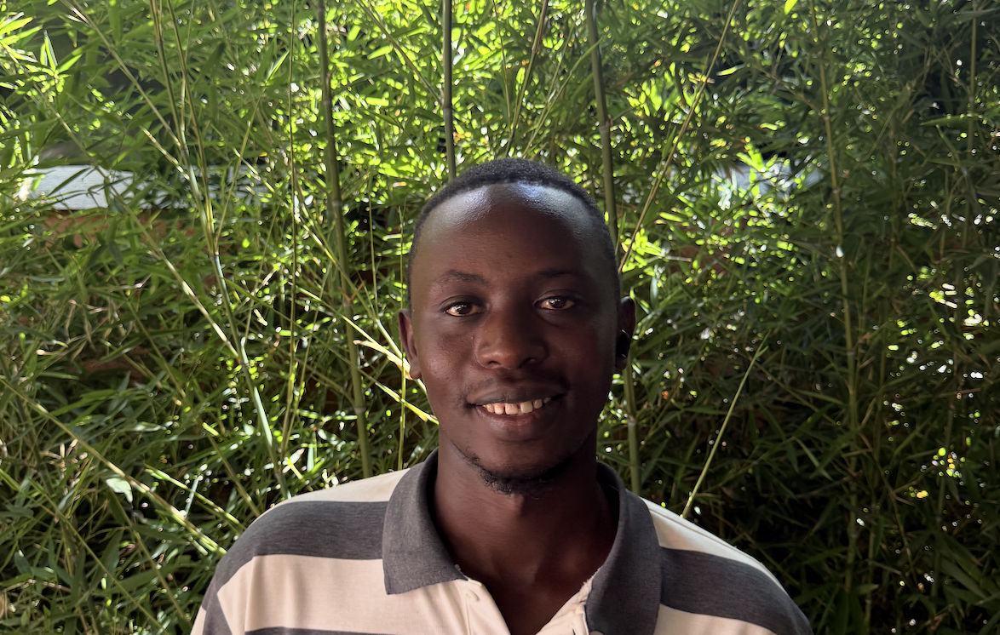

# How one young Rwandan blends passions for content creation and public health to save lives

**By Brady Foster**

_Rei Nzuwonizeye believes content creation can be the future of public health. Photo by Brady Foster_

Although only 25, Rei Nzuwonizeye is experienced in the health field. He has interned in a district office in Rwanda’s northern province where he went with a sanitation officer to teach people good hygienic habits. He educated people on how to safely prepare food and practice cleanliness. 

He has also worked at the [Byumba Level Two Teaching Hospital](https://www.byumbahospital.gov.rw) where he had an objective to teach people healthy habits, primarily through nutritional campaigns.

Nzuwonizeye is a public health student at the University of Rwanda and believes there is a need for health related knowledge in local Rwandan communities.

Having grown up in Kigali, Nzuwonizeye enjoys the many things the city has to offer, especially its bustling car free zones, multitude of cafes and restaurants, and vibrant entertainment scene. He also understands that there is a large void in knowledge of how to build good health and sanitation habits in many communities across Rwanda.

Today, digital content creation is rapidly growing in the country as an increasing number of residents gain access to the internet and smartphones. 

According to the most recent [Information and Communication Technology report](https://statistics.gov.rw/statistical-publications/ict-water-sanitation-energy-tourism-and-transport/ict) by the National Institute of Statistics of Rwanda, at least 38% of households in urban areas and 12% in rural areas have internet access.

The field of content creation is especially popular with university level students because it offers an additional source of revenue, while being flexible enough to fit around the busy demands of school. 

Nzuwonizeye uses digital content creation as a tool to communicate with different communities. He currently attends trainings where he and other aspiring content creators learn skills like digital design and video production to create content. 

Like many other content creators in Rwanda, Nzuwonizeye enjoys covering events happening in Kigali. “I take the pictures of the event” and “ask the community for comments”, Nzuwonizeye said on his process for covering these events. 

When it comes to informing the community about health, Nzuwonizeye brings together his knowledge as a student of public health and interest of content creation to reach people around the country. 

“The community in Rwanda needs info about research,” he said.

Nzuwonizeye shared that many do not have knowledge about medical research and treatments or know how to build habits to avoid disease and infection. He uses social media, primarily X, Instagram, and YouTube, as a platform to share his findings and teach people about these things. 

His process of informing people first involves conducting research about various diseases, then using this research as the basis for advising people. He then creates media such as infographics and audio commentary that informs about what preventative measures need to be taken to avoid illness. 

Recently, Nzuwonizeye worked on a project studying the effect of anthropogenic activities on malaria transmission. He found that communities with construction and farming activity are much more likely to suffer from malaria because these activities create ideal conditions for mosquitos to breed. 

He turned this research into information to share with the community on how to avoid malaria. His content shows people how they can survive malaria while living in areas with these high-risk activities. 

As internet penetration in Rwanda continues to increase, content creation becomes a more and more important tool to spread information to communities in need. Nzuwonizeye, and other young content creators like him, are using their skills and knowledge to educate people and bring positive changes to their communities.
